# apptesi — Simulatore di strategie di allocazione

App mobile **local-first** (Expo / React Native) per simulare e confrontare strategie di allocazione di portafoglio sui titoli dell'S&P 500, incluso un agente di **Deep Reinforcement Learning** eseguito direttamente sul dispositivo.

È il progetto applicativo della tesi di laurea triennale *"Valutazione del contributo del Deep Reinforcement Learning al volatility targeting"* (Università di Bologna, DISI). Candidato: Cesidio Rosica. Relatore: Prof. Federico Montori. A.A. 2025/2026.

> [!NOTE]
> L'app **non è uno strumento di trading**: è una sorta di laboratorio portatile. Tutti i portafogli sono simulati.

<p align="center">
  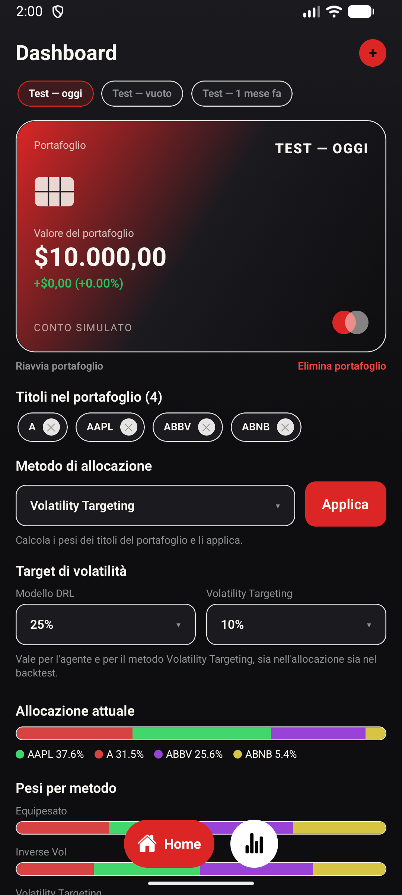
  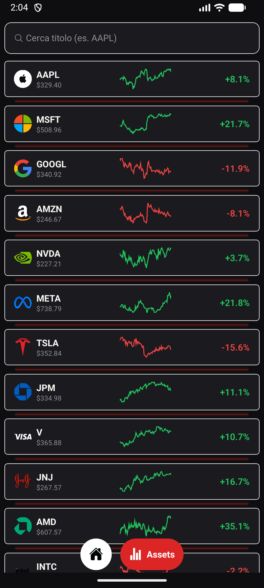
  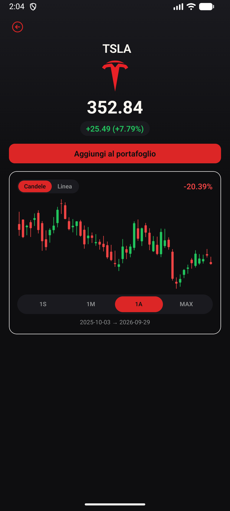
</p>

---

## Indice

- [Funzionalità](#funzionalità)
- [Strategie di allocazione](#strategie-di-allocazione)
- [Architettura](#architettura)
- [Struttura del progetto](#struttura-del-progetto)
- [Avvio rapido](#avvio-rapido)
- [Pipeline dei dati](#pipeline-dei-dati)
- [Il modello DRL e i risultati della tesi](#il-modello-drl-e-i-risultati-della-tesi)
- [Limiti](#limiti)

---

## Funzionalità

### Dashboard e gestione dei portafogli

- Più portafogli simulati, selezionabili dalla barra in alto.
- Creazione di un portafoglio con nome e capitale iniziale (obbligatori), commissioni in bps e costo base (facoltativi, 0 di default).
- Valore corrente e guadagno/perdita rispetto al capitale iniziale.
- Pulsanti per riavviare il portafoglio (ritorno al capitale iniziale) o eliminarlo.
- Rimozione di un titolo: la sua quota torna in liquidità e i pesi degli altri titoli non cambiano.

<p align="center">
  
  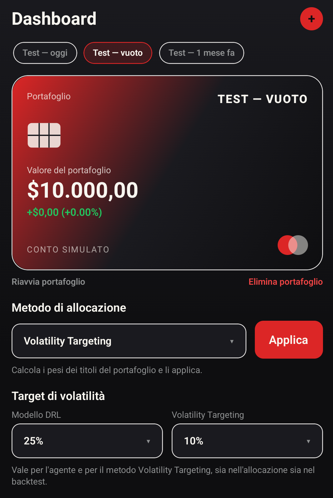
</p>

### Allocazione e backtest

- Si applica una delle cinque strategie al portafoglio. I costi di transazione vengono addebitati.
- Per il modello DRL e per il Volatility Targeting si può scegliere il target di volatilità annuo.
- Si vedono i pesi che ogni metodo assegnerebbe.
- Backtest walk-forward su un periodo configurabile (fino a 3 anni) con frequenza di ribilanciamento a scelta. Un grafico di equity e una tabella mettono a confronto le metriche: rendimento totale e annualizzato, volatilità, Sharpe, max drawdown e Calmar.

<p align="center">
  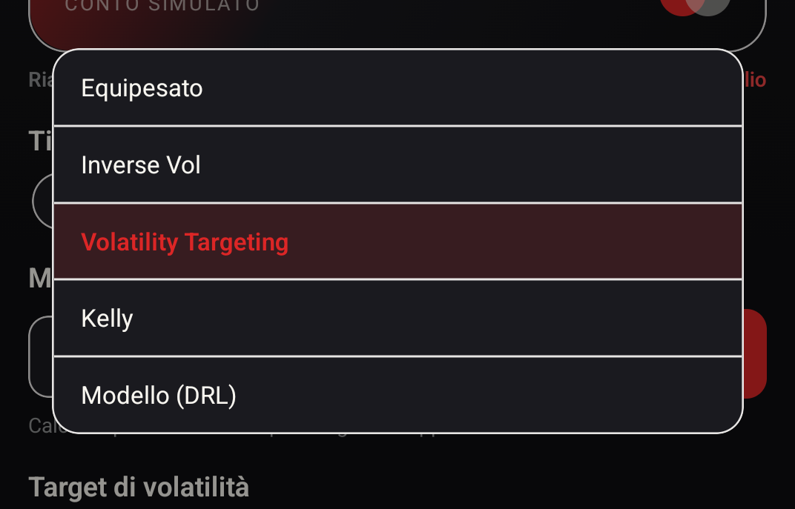
  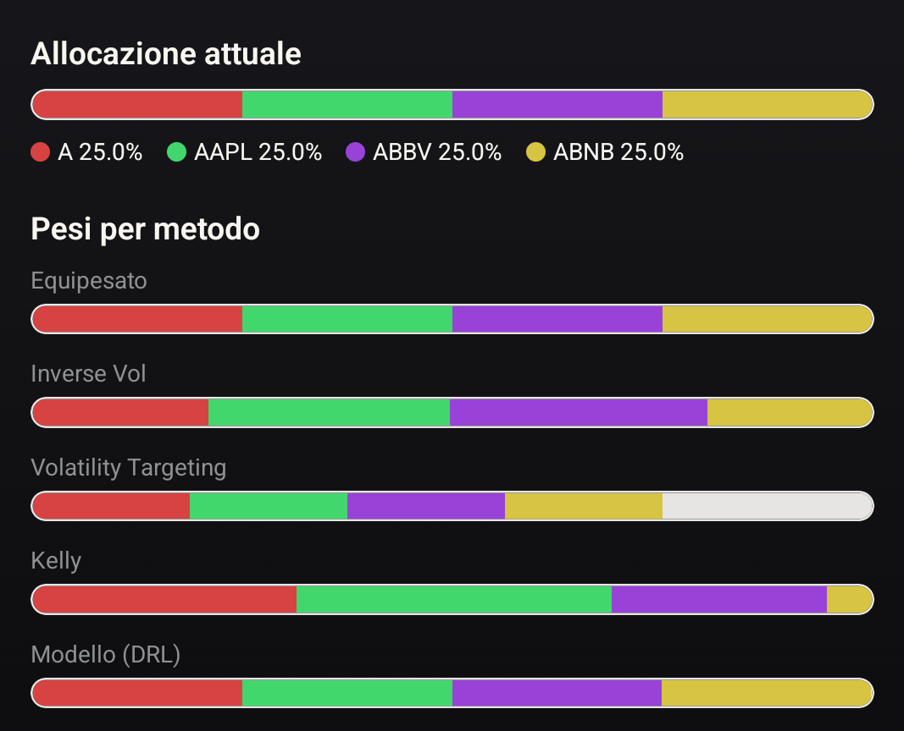
</p>
<p align="center">
  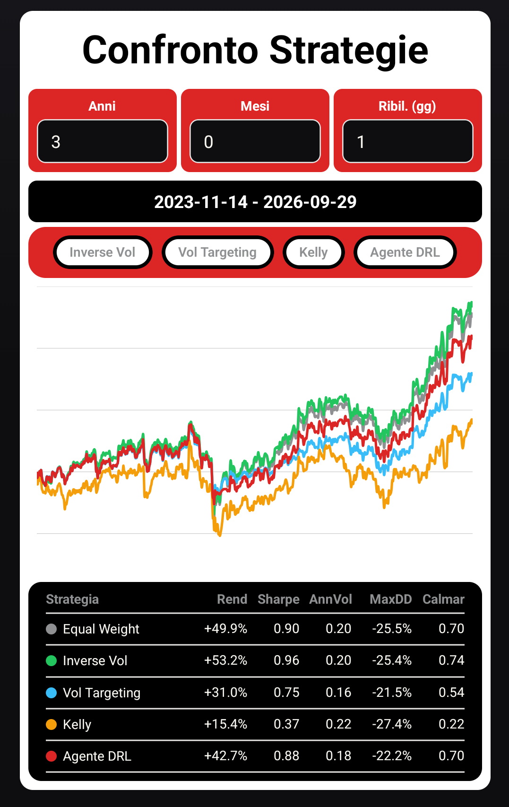
  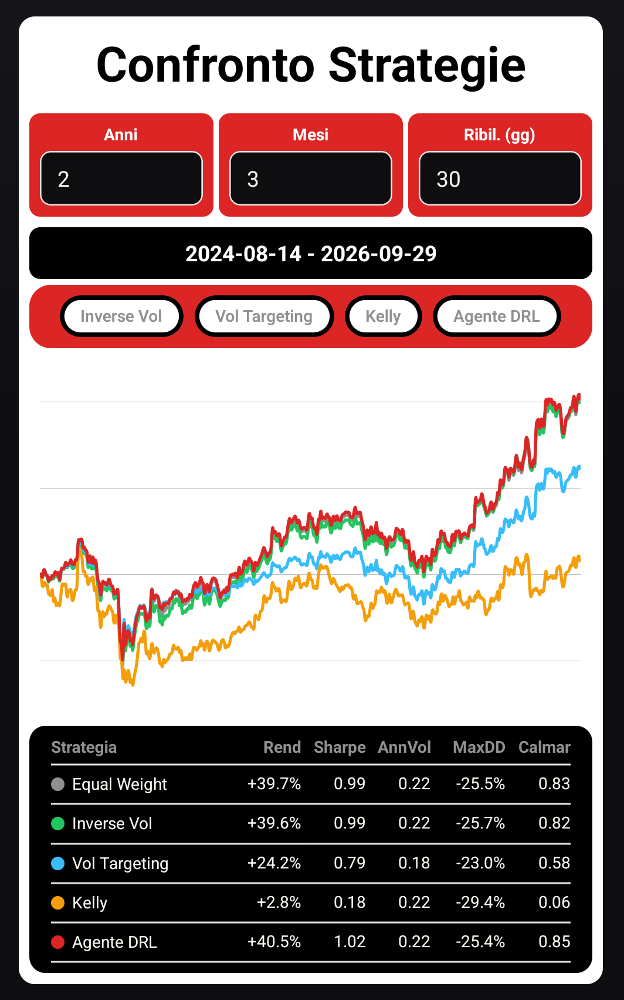
</p>

### Elenco e dettaglio dei titoli

- Elenco di tutti i titoli dell'S&P 500, con logo, ultimo prezzo, sparkline e variazione percentuale. Si possono cercare per ticker.
- Pagina di dettaglio con grafico a candele o a linea su 1 settimana, 1 mese, 1 anno o l'intero storico.
- Da qui si aggiunge il titolo a uno dei propri portafogli.

<p align="center">
  
  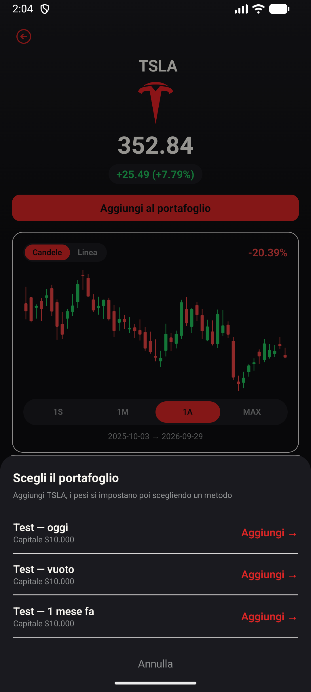
  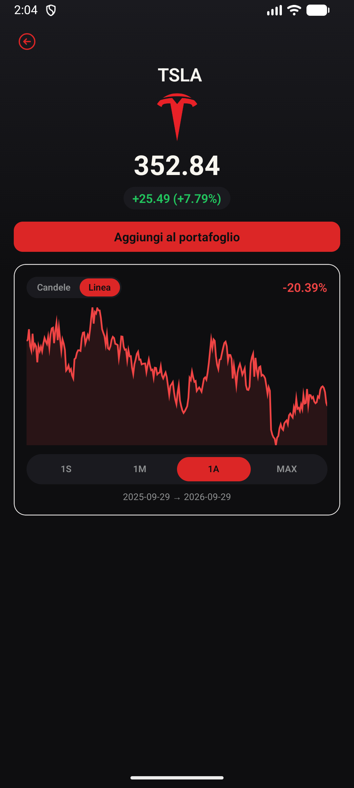
</p>

---

## Strategie di allocazione

| Strategia | Idea | Note implementative |
|---|---|---|
| **Equipesato** | Capitale diviso in parti uguali | — |
| **Inverse Volatility** | $w_i \propto 1/\sigma_i$ | Deviazione standard campionaria dei rendimenti, pesi normalizzati a 1 |
| **Kelly** | $f^* = \Sigma^{-1}\mu$, massimizza la crescita logaritmica | Covarianze fuori diagonale ridotte del 15%, Half-Kelly, solo posizioni long, leva massima 2 |
| **Volatility Targeting** | Esposizione $= \min(1,\ \sigma_{target}/\sigma_{port})$ | Forma classica ($p=1$), nessuna leva |
| **Modello DRL** | Moltiplicatore appreso $m_\theta$ applicato alla regola di Moreira–Muir ($p=2$) | Inferenza ONNX on-device, un modello per ogni target (15/20/25%) |

Implementazione: [src/utils/portfolioMethods.ts](src/utils/portfolioMethods.ts), [src/utils/finance.ts](src/utils/finance.ts), [src/utils/agentStrategy.ts](src/utils/agentStrategy.ts).

---

## Architettura

Tutta l'elaborazione avviene sul dispositivo: calcolo dei pesi, backtest e inferenza del modello. L'unico accesso alla rete è il download giornaliero dei prezzi di chiusura.

```
┌──────────────────── Produzione del dato ────────────────────┐
│ GitHub Actions (22:00 UTC, lun–ven)                         │
│   ml/download_sample.py  ──►  yfinance (S&P 500, 3 anni)    │
│                          ──►  data/prices.json(.gz)  ──► commit
└─────────────────────────────────────────────────────────────┘
                              │  download del .gz (~5,4 MB)
                              ▼
┌──────────────────── App (on-device) ────────────────────────┐
│ sync.ts ── fflate (gunzip) ──► SQLite + Drizzle ORM         │
│                                   │                         │
│        ┌──────────────────────────┼───────────────────┐     │
│        ▼                          ▼                   ▼     │
│  portfolioMethods.ts       backtest.ts         onnxModel.ts │
│  (pesi delle strategie)   (walk-forward)   (onnxruntime-rn) │
└─────────────────────────────────────────────────────────────┘
```

Perché local-first:

- **Privacy**: portafogli e risultati non escono mai dal dispositivo.
- **Offline**: dopo la prima sincronizzazione l'app funziona anche senza connessione. Il primo avvio usa un seed incluso nel bundle.
- **Nessun costo di infrastruttura**: non c'è un backend. Il dataset è versionato nel repository.

Altri dettagli:

- **Sincronizzazione** ([src/utils/sync.ts](src/utils/sync.ts)): al massimo una volta al giorno. Gli inserimenti sono idempotenti (upsert sulle chiavi primarie) e fatti a blocchi di ≤ 500 righe, per stare nel limite di variabili di SQLite. La finestra mobile è di 3 anni: lo storico viene riscritto perché `auto_adjust` ricalcola i prezzi passati dopo split e dividendi.
- **Database** ([db/schema.ts](db/schema.ts)): SQLite con Drizzle. Le migrazioni versionate in [drizzle/](drizzle/) vengono applicate all'avvio.
- **Backtest** ([src/utils/backtest.ts](src/utils/backtest.ts)): walk-forward senza look-ahead. Tiene conto dei costi di transazione proporzionali al turnover e del drift dei pesi tra un ribilanciamento e l'altro.
- **Validazione numerica**: l'implementazione TypeScript coincide con quella di riferimento in NumPy a meno di scarti dell'ordine di $10^{-16}$. L'inferenza ONNX in `float32` si discosta dal modello Python in `float64` di circa 0,3 punti percentuali (scarto mediano per asset).

---

## Struttura del progetto

```
src/
  app/                  # Routing file-based (expo-router)
    (tabs)/index.tsx    #   Dashboard
    (tabs)/assets.tsx   #   Elenco titoli
    asset/[ticker].tsx  #   Dettaglio titolo
  components/           # Card, grafici, selettori, liste
  context/              # PortfolioContext (stato dei portafogli)
  utils/                # Strategie, backtest, finanza, ONNX, sync
db/                     # Schema Drizzle, client, seed iniziale
drizzle/                # Migrazioni SQL generate
data/                   # Dataset prezzi (aggiornato dalla CI)
ml/                     # Script Python di download dei prezzi
assets/                 # Modelli ONNX (dnamm_tv15/20/25), loghi, icone
.github/workflows/      # Workflow di aggiornamento giornaliero
```

---

## Avvio rapido

**Requisiti:** Node.js, Android Studio (emulatore o dispositivo) e/o Xcode per iOS.

> [!IMPORTANT]
> L'app usa moduli nativi (`onnxruntime-react-native`, `expo-sqlite`, Skia), quindi **non funziona in Expo Go**. Serve una [development build](https://docs.expo.dev/develop/development-builds/introduction/).

```bash
npm install

# Build ed esecuzione su Android / iOS
npm run android
npm run ios

# Una volta installata la dev build, basta il dev server
npm start
```

Altri comandi:

```bash
npm run lint                 # ESLint
npx drizzle-kit generate     # Genera una nuova migrazione dopo aver modificato db/schema.ts
```

---

## Pipeline dei dati

Il workflow [.github/workflows/update-prices.yml](.github/workflows/update-prices.yml) gira alle 22:00 UTC dal lunedì al venerdì, dopo la chiusura del mercato USA. Si può anche lanciare a mano dalla tab *Actions*. Il workflow:

1. installa Python 3.12 con `yfinance`, `pandas` e `lxml`;
2. esegue [ml/download_sample.py](ml/download_sample.py). Lo script prende la lista dei ticker da Wikipedia (con una lista statica di riserva) e scarica 3 anni di dati giornalieri (high, low, close e VIX) un ticker alla volta;
3. fa il commit di `data/prices.json` (~33 MB) e della versione compressa `data/prices.json.gz` (~5,4 MB), che è quella scaricata dall'app.

Per aggiornare i dati in locale:

```bash
pip install yfinance pandas lxml
python ml/download_sample.py
```

---

## Il modello DRL e i risultati della tesi

L'agente prende una finestra di dati per ciascun asset e la elabora con una GRU condivisa seguita da mean-pooling. A questo aggiunge lo stato di rischio e i pesi precedenti. In uscita produce un **unico moltiplicatore** $m_\theta$ che corregge la formula di volatility targeting di Moreira e Muir:

$$e_t = m_\theta \cdot \left(\frac{\sigma_{target}}{\sigma_t}\right)^{p}, \quad p = 2$$

La selezione dei titoli è fissata a equal-weight, così si misura solo il contributo della parte appresa sulla decisione di esposizione. Il modello è stato addestrato in Python ed esportato in ONNX: i tre modelli (`assets/dnamm_tv{15,20,25}.onnx`) corrispondono ai tre target di volatilità.

**Conclusione della tesi:** l'agente converge sulla regola deterministica e finisce sulla sua frontiera cash–drawdown in tutti i regimi di mercato. Il minor drawdown viene dalla maggiore liquidità, non da un miglior tempismo, e nessuna ablation supera la formula fissa. La difesa funziona nei crolli rapidi (COVID 2020) e fallisce nei ribassi lenti (2022).

<p align="center">
  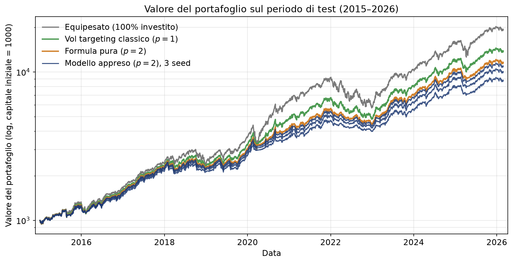
</p>
<p align="center"><em>Valore del portafoglio sul periodo di test (2015–2026), scala logaritmica.</em></p>

<p align="center">
  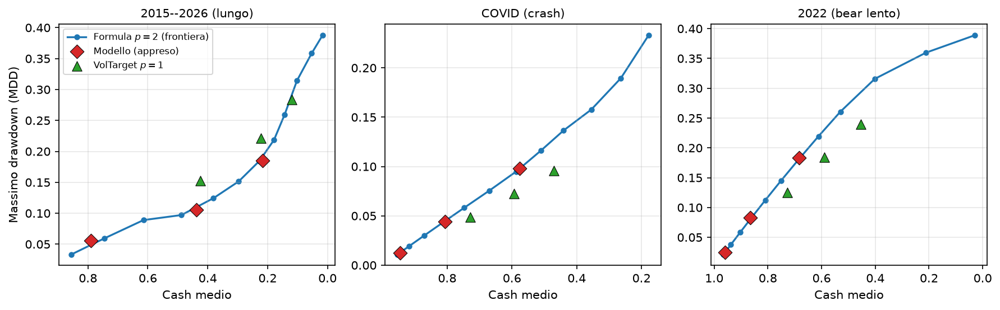
</p>
<p align="center"><em>Frontiera cash medio – max drawdown. Il modello appreso (rombi) cade sulla curva della formula fissa.</em></p>

---

## Limiti

- **Solo prezzi di chiusura giornalieri**: niente quotazioni in tempo reale né intraday.
- **Fonte non ufficiale**: `yfinance` usa un endpoint non documentato di Yahoo Finance, che può cambiare senza preavviso.
- **Distribuzione via repository**: va bene per pochi utenti, ma non regge un volume elevato.
- **Ambito del modello**: titoli large-cap USA, selezione dei titoli fissata, obiettivo di contenere il drawdown.
